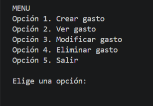
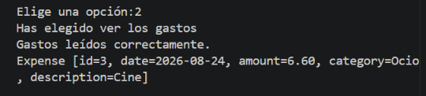
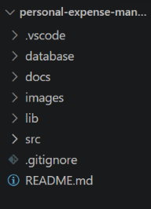

# 💰 Personal Expense Manager

Aplicación de consola desarrollada en Java para gestionar gastos personales mediante una base de datos PostgreSQL. Permite registrar, consultar, modificar y eliminar gastos de forma sencilla.

## 🚀 Descripción del proyecto

Este proyecto se ha desarrollado para practicar la programación en Java y aprender a conectar una aplicación con una base de datos relacional.

La aplicación utiliza un menú de consola desde el que se pueden gestionar los gastos personales, organizarlos por categorías y consultar la información almacenada en PostgreSQL.

## ✨ Funcionalidades

- **Registrar gastos:** guardar la fecha, el importe, la categoría y una descripción opcional.
- **Consultar gastos:** visualizar los gastos almacenados, ordenados por fecha.
- **Modificar gastos:** actualizar la información de un gasto mediante su identificador.
- **Eliminar gastos:** borrar un gasto seleccionado por su identificador.
- **Clasificar gastos:** organizar los registros en las categorías Alimentación, Transporte, Ocio, Hogar y Otros.

## 🛠️ Tecnologías y herramientas

- **Java:** desarrollo de la lógica de la aplicación.
- **PostgreSQL:** almacenamiento y gestión de los datos.
- **JDBC:** conexión entre Java y PostgreSQL.
- **SQL:** definición de la estructura de la base de datos.
- **Visual Studio Code:** entorno de desarrollo.
- **Git y GitHub:** control de versiones y publicación del proyecto.

## ⚙️ Proceso de desarrollo

Durante el desarrollo se han trabajado las siguientes fases:

1. Definición de la idea y de los requisitos del proyecto.
2. Diseño de la estructura de la base de datos y del modelo de datos.
3. Desarrollo de las clases Java para representar los gastos y gestionar las operaciones con la base de datos.
4. Implementación del menú de consola y de las operaciones CRUD.
5. Configuración de la conexión mediante JDBC.
6. Pruebas de funcionamiento y revisión de posibles mejoras.
7. Preparación de la documentación para publicar el proyecto en GitHub.

## 📸 Capturas de pantalla


### Menú principal



### Consulta de gastos



### Estructura del proyecto




## 📂 Estructura del proyecto

- `src/` — clases Java de la aplicación.
- `database/` — archivo SQL con la estructura de la tabla.
- `docs/` — documentación del proyecto.
- `images/` — capturas de pantalla.
- `lib/` — bibliotecas necesarias, incluido el controlador JDBC de PostgreSQL.
- `.vscode/` — configuración del entorno de desarrollo.
- `.gitignore` — archivos y configuraciones excluidos del control de versiones.
- `config.properties` — configuración local de la conexión a PostgreSQL; no debe publicarse.
- `README.md` — documentación principal del proyecto.

## ▶️ Cómo ejecutar el proyecto

### Requisitos previos

- Tener Java instalado.
- Tener PostgreSQL instalado y en funcionamiento.
- Disponer de Visual Studio Code con soporte para Java, o de un entorno equivalente.
- Contar con el controlador JDBC de PostgreSQL incluido en `lib/`.

### Preparación de la base de datos

1. Crear una base de datos llamada `personal_expense_manager` en PostgreSQL.
2. Ejecutar el archivo `database/schema.sql` para crear la tabla `EXPENSES`.

### Configuración de la conexión

Crear un archivo local llamado `config.properties` en la carpeta raíz del proyecto y configurar los datos de conexión correspondientes a la instalación de PostgreSQL:

```properties
db.url=jdbc:postgresql://localhost:5432/personal_expense_manager
db.user=TU_USUARIO
db.password=TU_CONTRASEÑA
```

Sustituir los valores de ejemplo por las credenciales locales correspondientes. Este archivo contiene configuración privada y no debe subirse al repositorio.

### Ejecución

1. Abrir la carpeta del proyecto en Visual Studio Code.
2. Comprobar que el controlador JDBC está reconocido por el entorno.
3. Ejecutar la clase `Main.java`.
4. Utilizar las opciones del menú para gestionar los gastos.

## 📚 Documentación

En la carpeta `docs/` se encuentra la documentación complementaria:

- [Decisiones del proyecto](docs/00-Decisiones.md).
- [Idea del proyecto](docs/01-Idea.md).
- [Requisitos](docs/02-Requisitos.md).
- [Base de datos](docs/03-BaseDatos.md).
- [Modelo de datos](docs/04-ModeloDatos.md).

## 🎯 Qué he aprendido

Este proyecto me ha permitido practicar la programación en Java, el uso de clases y objetos, las operaciones CRUD y la conexión con PostgreSQL mediante JDBC. También he trabajado con SQL, la organización de un proyecto, la documentación técnica y la preparación de un repositorio para GitHub.

## 🤖 Uso de la inteligencia artificial

He utilizado la inteligencia artificial como herramienta de apoyo para resolver dudas, revisar posibles mejoras y organizar la documentación. Las propuestas se contrastan con el código y las pruebas realizadas durante el desarrollo.